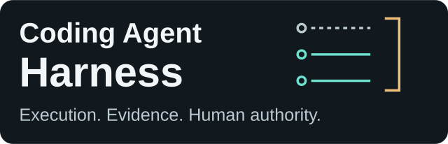
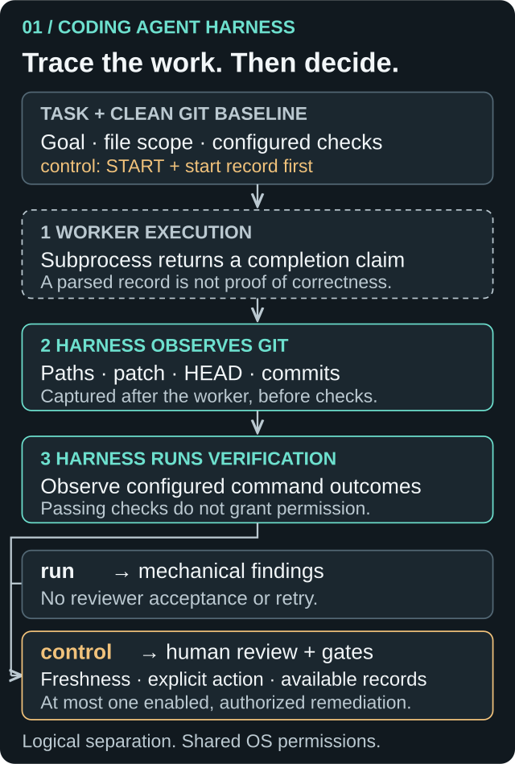
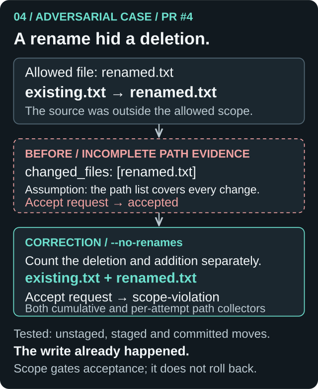

# 

**Completion is a claim. Acceptance needs evidence.**

A Python orchestration harness for bounded coding tasks. It runs a worker, collects Git evidence separately from the worker’s account, executes configured checks, and makes review an explicit step.

Built around a question: **what must be observed—and who must decide—before an agent’s work can be accepted?** The answer includes failure, disagreement, and permission to try again.

**Experimental · Python 3.12+ · Offline regression suite · Windows console review**

[Try the offline workflow](#try-it-without-a-model) · [Architecture](docs/architecture.md) · [CLI guide](docs/usage.md) · [Engineering findings](docs/engineering-notes.md)

## The problem with “done”

An agent’s completion claim is not independent evidence that the work was done correctly. A valid completion message cannot establish that the right files changed, that checks passed, or that a human authorized acceptance. A passing test also cannot decide whether another worker invocation is authorized.

The harness keeps three inputs separate: **what the worker claims**, **what Git records**, and **what configured verification observes**. “Independent” means collected outside the worker’s self-report; the processes still share the operator’s machine and permissions. Acceptance remains a separate decision.

## How it works

The caller supplies a task, acceptance criteria, file scope, and verification commands. The harness requires a clean Git baseline, invokes a worker process, captures Git evidence after it exits, and runs the checks.



*Read top to bottom: execute, observe, verify, then apply the selected workflow. Dashed cards mark claims, teal marks harness observations, and amber marks human authority. These are logical roles, not sandbox boundaries.*

There are two execution paths:

| | `run` — one invocation | `control` — human review |
| --- | --- | --- |
| Outcome | `ready-for-review` or `needs-attention` | Controller acceptance or a nonaccepted outcome |
| Authorization | Invoking the command starts the workflow | Fresh `START` confirmation before first dispatch |
| Review | Mechanical findings for the caller | Human sees claims, Git evidence, patch, and check results |
| Another attempt | None | At most one remediation, explicitly enabled and freshly authorized |
| Saved evidence | Optional Markdown report | Required start, review, and terminal JSON records |

**`ready-for-review` is not acceptance.** `control` is the provided human interface to `HarnessController`; it does not turn `run` into an approval workflow.

Git evidence is captured **after the worker, before verification**. In `control`, additional freshness checks reject Git-visible drift at review entry and immediately before a decision returns to the controller. These are point-in-time observations, not a lock on the repository.

## Try it without a model

From a clone, with Python 3.12+ and Git on `PATH`:

```powershell
python -m venv .venv
.\.venv\Scripts\Activate.ps1
python -m pip install -e ".[dev]"
coding-harness --help
python -m pytest tests/test_cli_integration.py -q
```

On POSIX, activate with `source .venv/bin/activate`.

The integration test creates a temporary repository and launches a synthetic Python worker through the real worker adapter. It changes a tracked file, adds a new file, collects real Git evidence, and runs independent content assertions. It checks that the command returns `ready-for-review`, the patch contains both changes, HEAD stays at the baseline, and the real index stays unstaged. **No model, credentials, or provider calls are needed.** This is a reproducible test demonstration, not a standalone demo command.

Exercise the human workflow's orchestration with scripted console input and a synthetic worker:

```powershell
python -m pytest tests/test_control.py -q
```

That suite covers authorization, one permitted remediation, freshness failures, and record publication. It does not replace manually testing a real Windows console. See the [CLI guide](docs/usage.md) for task JSON and configured-worker usage.

## Decisions that shape the system

The architecture grew through concrete failure investigation. Three decisions explain its shape.

### 1. Fix the evidence before trusting the gate

An allowlist only works if the changed-path evidence is complete. In the [R2 reproduction](docs/reliability-r2-findings.md#r2-1-rename-source-omitted-from-scope-evidence--high-severity), only `renamed.txt` was allowed. Moving `existing.txt` there could hide the deleted source from Git’s name-only output. An accepting reviewer then produced an accepted result.



*The correction changes evidence collection, not filesystem permissions. Both rename endpoints now count toward scope; the human-readable patch can still show a rename.*

[PR #4](https://github.com/MatiasLaukka/coding-agent-harness/pull/4) corrected both cumulative and per-attempt collectors. Regressions cover unstaged, staged, and committed moves, controller rejection, single-run findings, and exported handoff evidence. [See the failure, correction, and tests →](docs/engineering-notes.md#case-study-a-rename-hid-an-out-of-scope-deletion)

### 2. Make another attempt an explicit decision

The same review found that malformed reviewer output could fall through into remediation. Type annotations and model-instance identity were insufficient: the controller now rebuilds and validates each decision before branching, and requires an exact nonnegative integer retry budget.

The later `control` workflow makes the human boundary visible: `START` before the first dispatch; fresh action challenges for `ACCEPT` and `REMEDIATE`; decision publication and final freshness before callback return. Its scope stays fixed, with zero or one enabled remediation. The library separately supports explicit scope revision within a shared retry budget.

A saved request is not proof that the controller received or processed it. Records preserve those distinctions where observable. [Follow the authorization path →](docs/architecture.md#human-authority-in-control)

### 3. Prefer a narrower guarantee that the evidence supports

An output directory outside the checkout can still be a Git include, hook input, or watched resource. The final [reporting redesign](https://github.com/MatiasLaukka/coding-agent-harness/pull/8) removed recursive metadata scanning and adopted an operator-trusted, stable `--report-dir` contract. Known-root checks and create-only publication are useful; they cannot certify operational independence.

The same restraint applies to subprocess reliability: bounded waits and capture preserve incomplete output and cleanup uncertainty, without promising OS containment. [Engineering findings](docs/engineering-notes.md) trace the timeout and disclosure corrections to historical reproductions and current regressions.

These are AI-assisted development and review records, not independent human security audits.

## Supported interfaces

| Interface | Purpose |
| --- | --- |
| `coding-harness run` | Single worker invocation, Git evidence, verification, mechanical findings; optional `--report-dir DIR`. |
| `coding-harness control` | Foreground Windows console authorization and review; requires `--record-dir DIR`. |
| `coding-harness handoff validate` | Validate supervisor proposals and operator approval documents; optionally materialize a task file. |
| `coding-harness handoff preflight` | Check exact approved inputs and current repository identity without executing them. |
| Python `HarnessController` | Integrate a caller-supplied worker and reviewer, including audited scope revision. |

The provided adapter invokes a configured Qwen executable. A local executable does **not** imply local inference: its configuration determines the backend. No model, credentials, hosted planner, or hosted reviewer is bundled. The [CLI guide](docs/usage.md) documents options, exit codes, and the differences between CLI and library defaults.

## Offline supervisor handoff

The sidecar exchanges supervisor proposals, operator approvals, and evidence summaries without executing proposals. The single-run CLI and bare controller are **approval-unaware** with respect to these approval files; `control` has its own foreground human authorization.

The trusted caller must run `execution_preflight` against the exact objects before an explicit controller call. Summaries distinguish missing required history from unavailable **optional per-attempt** snapshots. Integrity hashes do not authenticate a human; protected approval storage and the caller's inventory of writable roots remain trust assumptions. See the [manual handoff guide](docs/supervisor-handoff.md).

## Verification and evidence

The offline suite uses temporary Git repositories, synthetic workers, scripted reviewers, real finite subprocesses, controlled clocks, and failure injection. It covers protocol ambiguity, rename scope, retry authority, timeouts, output limits, cleanup ownership, freshness, and publication failure.

```powershell
python -m pytest -q
```

[CI](.github/workflows/ci.yml) runs the suite on Ubuntu with Python 3.12 for main pushes and pull requests. Windows console behavior also has adapter tests with fake console events; this is not a CI guarantee for every terminal. Passing offline tests does not validate an installed Qwen backend, semantic correctness, or production readiness.

The [claim-to-source checklist](docs/portfolio-review.md#technical-claim-to-source-checklist) maps the important assertions to implementation and tests. Historical transcripts record their original revisions and environments, not current performance measurements.

## Limitations and non-goals

- **No sandbox.** Workers and checks run with the harness user's permissions. File scope detects violations and gates acceptance; it neither prevents writes nor rolls them back.
- **Git-visible evidence only.** Ignored files, external effects, and changes reverted before capture are outside the observation. Temporary indexes still write Git objects.
- **Checks are supplied by the caller.** Empty checks pass in `run` and the default library path; `control` requires a non-advisory check. Command behavior and reproducibility depend on the environment.
- **Freshness has a finite boundary.** `run` and default library reviewers do not recapture verifier/reviewer side effects before acceptance. `control` detects observed Git drift, but races remain between and after observations.
- **Saved records are sensitive and unauthenticated.** Reports and control records can contain source and output. Create-only publication does not make them tamper-proof, crash-durable, or executable resume checkpoints.
- **Output directories require operator judgment.** An external directory can still be a Git include, hook input, or watched resource. The harness checks known root overlap; it cannot certify complete operational independence.
- **Bounded waits are not OS containment.** Descendants may escape observation; blocked OS calls and cleanup uncertainty remain possible. No universal hard wall-clock guarantee is claimed.
- No automatic rollback, provider routing, live supervisor adapter, or automatic push, pull request, or merge. Dependencies are lower-bounded rather than locked.

## Engineering case study

An eight-slide explanation of the architecture, failure cases, and evidence boundaries: [view the PDF](docs/portfolio/coding-agent-harness-case-study.pdf) · [download the editable PowerPoint](docs/portfolio/coding-agent-harness-case-study.pptx). See the [architecture](docs/architecture.md), [engineering decisions](docs/engineering-decisions.md), [speaker notes](docs/portfolio/speaker-notes.md), and [evidence checklist](docs/portfolio/evidence-checklist.md).

## Explore the implementation

- [Architecture and trust boundaries](docs/architecture.md) — evidence lineage, authority, controller API.
- [CLI and task guide](docs/usage.md) — setup, exact options, human workflow, exit codes.
- [Single-run report contract](docs/reports.md) — trusted directory, captured content, publication failures.
- [Offline supervisor handoff](docs/supervisor-handoff.md) — proposals, exact approval bindings, nonexecuting preflight.
- [Engineering findings](docs/engineering-notes.md) — rename scope, subprocess deadlines, and failure disclosure.
- [Documentation review](docs/portfolio-review.md) — audit, before/after outline, claim sources, validation limits.

Initiated and directed by **Matias Laukka** as an investigation into supervised coding agents and reliable evaluation. He set requirements and priorities, reviewed results, and made acceptance decisions, with extensive AI collaboration across architecture, implementation, investigation, testing, and adversarial review.

MIT · [License](LICENSE)
