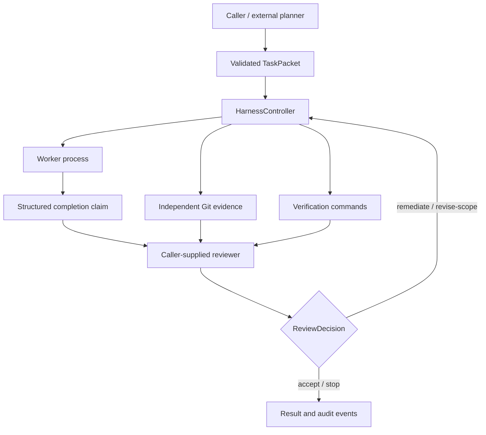

# Coding Agent Harness

A Python prototype for delegating bounded coding tasks to a local worker process, collecting independent evidence, and keeping acceptance decisions under reviewer control.

The central idea is simple: a worker's completion message is a claim. Git changes and verification results provide separate evidence for evaluating that claim.

**Status:** experimental, version 0.1.0. The controller and single-run CLI are covered by offline tests, including real Git evidence and an offline worker subprocess. Limited real local Qwen Code/Ollama experiments have exercised coding tasks and controller acceptance, with both accepted and stopped outcomes. These experiments do not establish repeatability, comprehensive backend validation or production readiness.

## Architecture



| Component | Responsibility |
| --- | --- |
| `models.py` | Strict task, completion, verification-command, and review-decision schemas; unknown fields are rejected. |
| `worker.py` | Qwen CLI subprocess adapter, task prompt, `HARNESS_RESULT:` parsing, and worker outcome classification. |
| `git.py` | Clean baseline, cumulative patch/status/commit evidence, and dirty-safe per-attempt snapshots. |
| `verifier.py` / `process.py` | Independent command execution, output and exit-code capture, timeouts, and process-tree termination. |
| `controller.py` | Reviewer-driven acceptance, audited scope changes, and a shared bounded retry budget. |
| `orchestrator.py` / `cli.py` | Separate single-run path with mechanical findings and a console review surface. |

### Planner, worker, and reviewer boundaries

The caller supplies a `TaskPacket`: goal, constraints, acceptance criteria, suggested files, and optional allowed files. Planning is an upstream responsibility; no hosted planner adapter or provider SDK is implemented here.

`QwenWorker` invokes a caller-configured executable as `qwen --model <model> -p <prompt>`. It expects exactly one JSON completion line prefixed by `HARNESS_RESULT:`. Multiple records or duplicate JSON keys are protocol failures; raw process output remains available. The result contains `status`, `summary`, `changed_files`, and `remaining_concerns`. Changed-file claims refer only to the current worker invocation. A local subprocess does not imply local model inference; the Qwen executable's own configuration determines its backend.

The controller accepts a caller-supplied reviewer with a `review(...)` method. It receives the current task, worker result and assessment, cumulative Git evidence, verification results, and attempt number, and returns a `ReviewDecision`: `accept`, `remediate`, `stop`, or `revise-scope`. No concrete hosted reviewer integration is included.

### Independent Git evidence

A run starts from a clean Git repository. Evidence is captured immediately after each worker invocation, before verification and review. Cumulative evidence remains anchored to the original commit and includes changed paths, a patch including non-ignored untracked files, observed status/HEAD, and newly created commits.

Before each worker invocation, the controller captures the current worktree using a temporary Git index and `write-tree`. After the invocation, it compares trees to obtain that attempt's changes without staging files in the real index. This works across remediation attempts even when previous attempts left changes in the worktree.

Worker/Git disagreement is an audit event in the controller, not an acceptance veto. Git-observed cumulative changes remain authoritative for scope checks. The separate single-run orchestrator reports disagreement as a mechanical finding.

### Verification, scope, and bounded remediation

Verification commands are argument arrays executed independently after each worker attempt. Results record exit code, timeout, stdout, stderr, and elapsed time. This is deterministic command-based gating; reproducibility still depends on the supplied commands and environment.

- `must_pass` (default): a nonzero exit or timeout prevents acceptance.
- `expected_failure`: requires a reason; an ordinary failure meets the expectation, an unexpected pass is audited, and a timeout prevents overall success.
- `advisory`: recorded without affecting overall success.

An empty command list performs no checks and currently yields success. Callers must supply meaningful verification.

`allowed_files=None` imposes no file restriction; `[]` permits no changed files; a list is an exact repository-relative allowlist. Scope checks detect cumulative out-of-scope changes immediately after the worker invocation. Rename sources and destinations are both changed paths and both require allowlist coverage. They do not prevent writes or roll them back. Filesystem changes made by verification commands or the reviewer are not recaptured before acceptance. A reviewer can explicitly revise scope with a nonempty list and rationale; the revision is audited and subsequent remediation preserves it.

Remediation and scope revision share `max_remediation_attempts` (default 2), allowing at most three worker invocations by default. The reviewer cannot accept an execution/protocol failure, a scope violation, or failed required verification. A valid worker report of `blocked` or `failed` may be accepted by the reviewer with a disagreement audit event.

## Installation

Requires Python 3.12+ and Git on `PATH`. From a clone of this repository:

```powershell
python -m venv .venv
.\.venv\Scripts\Activate.ps1
python -m pip install -e ".[dev]"
coding-harness --help
```

On POSIX shells, activate with `source .venv/bin/activate`. Running a real worker also requires an independently installed and configured Qwen executable and an available model identifier. No models, credentials, or provider configuration are bundled.

## Usage

### Task specification

The CLI reads a JSON object with `task` and `verification_commands`. Save the task file outside the clean target repository, or track and commit it before starting a run. For example:

```json
{
  "task": {
    "task_id": "bounded-fix",
    "goal": "Correct the edge case in src/example.py.",
    "constraints": ["Do not change unrelated behavior."],
    "acceptance": ["The existing example tests pass."],
    "suggested_files": ["src/example.py"],
    "allowed_files": ["src/example.py"]
  },
  "verification_commands": [
    {
      "id": "focused-tests",
      "argv": ["python", "-m", "pytest", "tests/test_example.py", "-q"],
      "timeout_seconds": 120,
      "expectation": "must_pass"
    }
  ]
}
```

Adapt the paths and commands to the target project. Verification executables resolve in the harness process's environment; activate the appropriate environment before running.

### CLI

```powershell
coding-harness run --help
coding-harness run task.json --repo ..\target-worktree --model YOUR_CONFIGURED_QWEN_MODEL
```

`YOUR_CONFIGURED_QWEN_MODEL` is a placeholder for your configured model identifier. Implemented options are `--repo`, `--model`, `--qwen-command` (default `qwen`), `--worker-timeout` (default 600 seconds), and optional `--report PATH`.

The CLI calls the single-run orchestrator, not `HarnessController`; it does not expose reviewer-controlled remediation. Its result codes are 0 for `ready-for-review`, 2 for mechanical findings, and 1 for loading/runtime errors. Ready for review is not reviewer acceptance.

### Saved single-run reports

```powershell
coding-harness run task.json --repo ..\target-worktree --model YOUR_CONFIGURED_QWEN_MODEL --report ..\reports\run-001.md
```

Reports are opt-in. Choose a new file in an existing, writable directory outside
both the target repository and its Git metadata (including linked-worktree common
metadata). Relative paths are relative to the harness process's working directory.
Existing files, directories, and symlinks are rejected before worker setup. Git
layout is established before dispatch by one fixed, read-only `git rev-parse`
query, using the existing bounded process runner (10-second phase budget, 16 KiB
stdout and 4 KiB stderr limits). Optional Git locks and fsmonitor are disabled;
no worker, hook, verification, status, diff, or evidence collection is requested.
The supplied target, actual worktree, Git admin/common directories, and bound
`.git` discovery location are all protected, including `core.worktree` redirects.
An ignored nested `.git` directory cannot narrow those exclusions. Standard `.git`
files and linked worktrees are supported. Bare repositories, unavailable Git,
failed/incomplete discovery, ambiguous multiline paths, and unrecognized or over
4 KiB Git layout files fail closed. Git layout environment overrides remain
unsupported.

The report retains the returned task requirements, captured outcome and findings,
untrusted worker claims, observed worker process output and capture flags,
independent Git paths and SHAs, ordered verification specifications and results,
and the captured patch. **ready-for-review is not reviewer acceptance.** This
single-run path records no reviewer acceptance. Zero configured checks and missing
worker completion are shown explicitly. Markdown prose is escaped, and captured
logs and patches use fences longer than embedded backtick runs.

**Reports may contain sensitive local code and output**, task prose, command
arguments, paths, and worker claims. They are not redacted or signed. Review them
before sharing. Treat report contents as untrusted material, including instructions
or links appearing inside captured output.

Only executions returning `TaskRunResult` produce completed-run reports, including
`needs-attention`. An exception or interruption before that return retains existing
sanitized failure reporting and produces no completed-run report. Rendering reads
only captured records; it performs no worker invocation, verification, or Git
evidence recollection. Git evidence remains the snapshot taken after the worker
and before verification; later verification side effects are outside it.

Publication writes UTF-8 to a private temporary file in the output directory,
flushes and fsyncs it, closes it, then uses an atomic create-only hard link. A
concurrent destination wins without being overwritten. Write/publication failures
remove the temporary file where the OS permits and return exit code 1, preserving
the console's captured run outcome. Otherwise existing console output and exit
codes (0 or 2) are unchanged. Filesystems without hard-link support fail closed;
there is no overwrite fallback. Cleanup failure can leave a temporary file or an
already complete published report and also returns 1. A process crash can leave a
temporary file; publication is not a crash-durable archive (directory metadata is
not fsynced).

Use a trusted output directory whose ancestors cannot be replaced by another
process. The CLI freezes discovered roots before dispatch; publication rechecks
filesystem paths against those roots without any post-dispatch Git query or fresh
run evidence. These are point-in-time checks, not containment against a hostile process
swapping directories or junctions during publication. This feature adds no
approval, remediation, resume, controller-history, or supervisor workflow.

### Controller integration

For reviewer-driven runs, use `HarnessController(worker=..., reviewer=..., max_remediation_attempts=2)` and call `run(task=..., repo_dir=..., verification_commands=...)`. Supply a worker implementing `run(*, task, repo_dir)` and a reviewer implementing:

```python
review(*, task, worker_result, worker_assessment, evidence, verification, attempt)
```

The reviewer must return a validated `ReviewDecision`. The controller revalidates it before branching; malformed decisions raise without authorizing another worker invocation. Remediation budgets must be nonnegative integers; booleans and nonfinite or fractional values are rejected. `QwenWorker` is the provided worker adapter. Integration with a human review UI or hosted model is left to the caller. The returned `HarnessRunResult` contains status, attempt count, and audit events; evidence is passed to the reviewer rather than persisted automatically.

## Offline supervisor handoff

The sidecar in `coding_agent_harness.supervisor` exchanges three strict JSON
documents: `SupervisorProposal`, `OperatorApproval`, and `HandoffSummary`.
It makes no model calls and never executes a proposal. An external supervisor
can propose a task, review, escalation, or stop. A review is a recommendation;
it is never substituted for a controller decision. An acceptance recommendation
may only acknowledge an already accepted, consistently recorded controller run.

Proposals reuse `TaskPacket`, ordered `VerificationCommand` records and an
`ExecutionConfig`. They require an explicit exact file allowlist (an empty list
permits no edits), unique checks including a required check, finite timeouts,
and zero remediation retries. Worker argv, model and optional runtime limits
are operator-selected data, not executed during validation. CLI limit support
and actual launcher/provider settings remain the operator's responsibility.

### One manually supervised round trip

Use a clean disposable target, an exchange directory, and a **protected operator
directory outside every worker- and supervisor-writable workspace**. Inspect
the complete proposed task, file scope, checks and execution settings first.
The following is an operator-side example for an initial task proposal.
`proposal.json` is written by the supervisor into the exchange directory;
the operator supplies the paths and a trusted existing reviewer.

```python
from pathlib import Path
from coding_agent_harness.supervisor import (
    OperatorApproval, canonical_json, canonical_digest, inspect_repository,
    load_proposal,
)

repo = Path("target-worktree").resolve()
exchange = Path("supervisor-exchange").resolve()
approval_dir = Path("operator-controlled-approvals").resolve()
proposal = load_proposal(exchange / "proposal.json")
spec = proposal.task_spec
assert proposal.action == "task"
assert inspect_repository(repo) == proposal.repository

# HUMAN CHECKPOINT: inspect spec.task, spec.verification_commands and
# spec.execution_config before creating this exact approval.
approval = OperatorApproval(
    proposal_sha256=canonical_digest(proposal),
    repository=proposal.repository,
    task_sha256=canonical_digest(spec.task),
    allowed_files=list(spec.task.allowed_files),
    verification_sha256=canonical_digest([
        check.model_dump(mode="json") for check in spec.verification_commands
    ]),
    execution_config_sha256=canonical_digest(spec.execution_config),
    approve_task=True, approve_scope=True,
    approve_checks=True, approve_configuration=True,
)
# Operator creates this file; never expose approval_dir to the supervisor.
approval_path = approval_dir / "approved.json"
with approval_path.open("xb") as stream:
    stream.write(canonical_json(approval))
```

Document validation may create an existing-compatible task file. It reports
`approval_validated`, which is distinct from a fresh execution preflight:

```powershell
coding-harness handoff validate supervisor-exchange/proposal.json `
  --repo target-worktree --approval operator-controlled-approvals/approved.json `
  --approval-dir operator-controlled-approvals --untrusted-root supervisor-exchange `
  --output task.json

coding-harness handoff preflight supervisor-exchange/proposal.json `
  --repo target-worktree --approval operator-controlled-approvals/approved.json `
  --approval-dir operator-controlled-approvals --untrusted-root supervisor-exchange `
  --task-file task.json --execution-config execution-config.json
```

`execution-config.json` must contain the exact approved `ExecutionConfig`.
`--untrusted-root` is repeatable: supply every additional worker/supervisor
writable root; the target is always included. Use `--handoff summary.json` for
proposals referring to a prior run. Validation/preflight return 0 on success,
2 for missing approval or failed preflight, and 1 for malformed/contradictory
documents or output errors. Outputs are create-only and errors do not echo
untrusted input. No supervisor execute or approval-writing CLI exists.

Immediately before an explicit controller call, the **trusted caller** must
reread approval and check the actual objects it will execute:

```python
from coding_agent_harness.controller import HarnessController
from coding_agent_harness.worker import QwenWorker
from coding_agent_harness.supervisor import (
    ExceptionObservation, RecordedRun, RecordingReviewer, build_handoff,
    execution_preflight, write_handoff,
)

cfg = spec.execution_config
# Operator has separately verified argv, CLI limits and local runtime settings.
worker = QwenWorker(command=cfg.command_prefix, model=cfg.model,
                    timeout_seconds=cfg.worker_timeout_seconds)
recorder = RecordingReviewer(trusted_reviewer)  # Supplied by the operator.
controller = HarnessController(worker=worker, reviewer=recorder,
                               max_remediation_attempts=cfg.max_remediation_attempts)
preflight = execution_preflight(
    proposal, handoff=None, approval_path=approval_path,
    trusted_approval_dir=approval_dir,
    untrusted_workspace_roots=[exchange], repo_dir=repo,
    task=spec.task, verification_commands=spec.verification_commands,
    execution_config=cfg,
)
if not preflight.passed:
    raise RuntimeError("Preflight failed; do not invoke the worker")

result = None
exception = None
observed_error = None
try:
    result = controller.run(task=spec.task, repo_dir=repo,
                            verification_commands=spec.verification_commands)
except Exception as error:
    observed_error = error
    # An exception is not an invented stopped/accepted HarnessRunResult.
    exception = ExceptionObservation(stage="controller",
                                     type_name=type(error).__name__)
record = RecordedRun(
    run_id="supervised-run", original_task=spec.task,
    verification_commands=spec.verification_commands,
    baseline=preflight.repository, baseline_source="trusted_preflight",
    controller_max_remediation_attempts=cfg.max_remediation_attempts,
    callbacks=recorder.records, result=result, exception=exception,
)
write_handoff(exchange / "summary.json", build_handoff(record))
if observed_error is not None:
    raise observed_error
# Inspect the summary before sharing it.
```

The supervisor can now read the summary and propose another narrow task or a
nonexecuting remediation/escalation/stop recommendation. The operator decides
whether to continue. A nested follow-up task is context only: execution needs
a separately submitted task proposal, exact new approval and a clean approved
baseline. The sidecar never commits, cleans or promotes a stopped run's state.

### Evidence and trust limitations

`RecordingReviewer` copies callback inputs, returns the delegate's exact
decision, and re-raises reviewer exceptions. Export checks original task and
baseline identities, ordered checks and verifier semantics, retry lineage,
final controller branches and observable audit payloads/order. Contradictory
provenance is rejected; original source records and controller results are
never repaired or replaced. Missing required callbacks/baseline/budget are
explicit. Unavailable **optional per-attempt** Git snapshots are separate:
an actual accepted result with complete required callback history remains
reportable. Dependent audit details are preserved but not claimed independently
verified; missing snapshots or audits are never reconstructed.

Summaries separate worker completion claims from Git observations, process
status, verification outcomes and recorded reviewer decisions. File-scope
compliance does not prove semantic task-scope compliance:
`semantic_task_scope` is always `not_assessed_by_handoff`. Valid blocked/failed
worker acceptance retains existing controller semantics and disagreement audits.

Wire JSON is limited to 64 KiB, 32 attempts and 64 checks/paths/audits; excess
is rejected rather than truncated. Duplicate keys, scalar coercion, unsupported
versions/actions and ambiguous Windows/Git-internal proposal paths are rejected.
Hashes use UTF-8 sorted-key compact JSON with defaults/nulls and ordered arrays,
without Unicode normalization; this is not RFC 8785. Default summaries omit
logs, diffs, argv, free-form summaries/rationales and status text. Retained labels
and paths are SHA-256 pseudonyms; original source digests and counts are retained.
These summaries can ground a next-step request but cannot alone prove semantic
correctness. Inspect them before sharing; metadata/digests are not a secrecy
guarantee, and additional evidence needs separate operator review.

**Integrity hashes do not authenticate a human.** The operator directory and
caller inventory of writable roots are trusted; resolved-path checks are not
ACL enforcement. Same-user workers may otherwise write anywhere. Filesystem
compromise or forged approvals within the trusted directory are outside this
prototype's guarantees. There is no signature/authentication service or sandbox.

The existing run CLI and controller remain **approval-unaware**. A direct caller
can bypass the sidecar. Preflight uses fixed read-only Git commands with optional
locking and filesystem monitoring disabled; it does not run approved argv,
workers or checks. A pass is a point-in-time observation, not a lock or execution
capability. Repeat it if documents, Git state or runtime configuration change.
Ignored files, hidden settings, concurrent modifications and verifier/reviewer
side effects remain limitations. No live hosted supervisor integration exists;
a future adapter reads summaries and writes proposals, without receiving an
approval writer or process/controller capability.

## Testing

```powershell
python -m pytest -q
python -m pytest tests/test_controller.py -q
```

Tests use fake workers/reviewers and temporary Git repositories. They cover schemas, process execution/timeouts, Git evidence, worker protocol/outcomes, verification expectations, CLI presentation, scope checks, and bounded remediation. They do not require live model calls. An offline CLI integration test exercises the real worker adapter, Git evidence, and verification commands using a synthetic worker process. Passing offline tests does not validate an installed Qwen backend.

## Limitations

- No sandbox: workers and verification commands run with the harness user's permissions. Use trusted commands and an isolated target worktree.
- Scope enforcement is detection and acceptance gating, not filesystem access control. Verification/reviewer side effects fall outside the captured worker evidence; use checks and reviewers that do not modify the target worktree.
- Git snapshots cover Git-visible state, not ignored files, external side effects, or changes that are reverted before capture. Temporary indexes still write Git objects to the repository's object store.
- No built-in hosted planner/reviewer adapters, multi-provider routing, automatic rollback, or durable audit storage.
- Dependency versions are lower-bounded rather than locked; cross-platform behavior and live worker integrations need additional validation.
- The library controller and single-run CLI are separate execution paths; reviewer-controlled remediation is available through the controller API.

## License

MIT. See [LICENSE](LICENSE).
