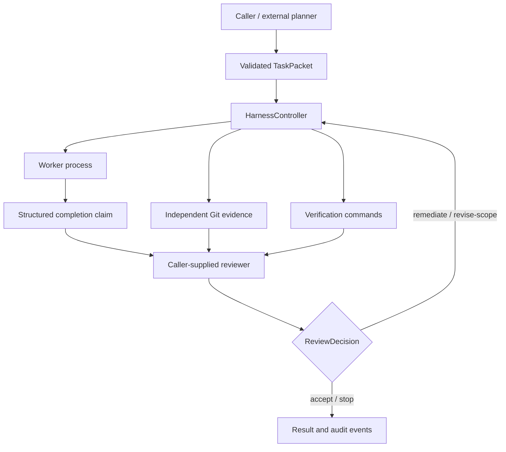

# Coding Agent Harness

A Python prototype for delegating bounded coding tasks to a local worker process, collecting independent evidence, and keeping acceptance decisions under reviewer control.

The central idea is simple: a worker's completion message is a claim. Git changes and verification results provide separate evidence for evaluating that claim.

**Status:** experimental, version 0.1.0. The controller and single-run CLI are covered by offline tests, including real Git evidence and an offline worker subprocess. Live Qwen backends and production deployment remain unvalidated.

## Architecture



| Component | Responsibility |
| --- | --- |
| `models.py` | Strict task, completion, verification-command, and review-decision schemas; unknown fields are rejected. |
| `worker.py` | Qwen CLI subprocess adapter, task prompt, `HARNESS_RESULT:` parsing, and worker outcome classification. |
| `git.py` | Clean baseline, cumulative patch/status/commit evidence, and dirty-safe per-attempt snapshots. |
| `verifier.py` / `process.py` | Independent command execution, output and exit-code capture, timeouts, and process-tree termination. |
| `controller.py` | Reviewer-driven acceptance, audited scope changes, and a shared bounded retry budget. |
| `orchestrator.py` / `cli.py` | Separate single-run path with mechanical findings and a console review surface. |

### Planner, worker, and reviewer boundaries

The caller supplies a `TaskPacket`: goal, constraints, acceptance criteria, suggested files, and optional allowed files. Planning is an upstream responsibility; no hosted planner adapter or provider SDK is implemented here.

`QwenWorker` invokes a caller-configured executable as `qwen --model <model> -p <prompt>`. It expects a final JSON completion line prefixed by `HARNESS_RESULT:`. The result contains `status`, `summary`, `changed_files`, and `remaining_concerns`. Changed-file claims refer only to the current worker invocation. A local subprocess does not imply local model inference; the Qwen executable's own configuration determines its backend.

The controller accepts a caller-supplied reviewer with a `review(...)` method. It receives the current task, worker result and assessment, cumulative Git evidence, verification results, and attempt number, and returns a `ReviewDecision`: `accept`, `remediate`, `stop`, or `revise-scope`. No concrete hosted reviewer integration is included.

### Independent Git evidence

A run starts from a clean Git repository. Evidence is captured immediately after each worker invocation, before verification and review. Cumulative evidence remains anchored to the original commit and includes changed paths, a patch including non-ignored untracked files, observed status/HEAD, and newly created commits.

Before each worker invocation, the controller captures the current worktree using a temporary Git index and `write-tree`. After the invocation, it compares trees to obtain that attempt's changes without staging files in the real index. This works across remediation attempts even when previous attempts left changes in the worktree.

Worker/Git disagreement is an audit event in the controller, not an acceptance veto. Git-observed cumulative changes remain authoritative for scope checks. The separate single-run orchestrator reports disagreement as a mechanical finding.

### Verification, scope, and bounded remediation

Verification commands are argument arrays executed independently after each worker attempt. Results record exit code, timeout, stdout, stderr, and elapsed time. This is deterministic command-based gating; reproducibility still depends on the supplied commands and environment.

- `must_pass` (default): a nonzero exit or timeout prevents acceptance.
- `expected_failure`: requires a reason; an ordinary failure meets the expectation, an unexpected pass is audited, and a timeout prevents overall success.
- `advisory`: recorded without affecting overall success.

An empty command list performs no checks and currently yields success. Callers must supply meaningful verification.

`allowed_files=None` imposes no file restriction; `[]` permits no changed files; a list is an exact repository-relative allowlist. Scope checks detect cumulative out-of-scope changes immediately after the worker invocation. They do not prevent writes or roll them back. Filesystem changes made by verification commands or the reviewer are not recaptured before acceptance. A reviewer can explicitly revise scope with a nonempty list and rationale; the revision is audited and subsequent remediation preserves it.

Remediation and scope revision share `max_remediation_attempts` (default 2), allowing at most three worker invocations by default. The reviewer cannot accept an execution/protocol failure, a scope violation, or failed required verification. A valid worker report of `blocked` or `failed` may be accepted by the reviewer with a disagreement audit event.

## Installation

Requires Python 3.12+ and Git on `PATH`. From a clone of this repository:

```powershell
python -m venv .venv
.\.venv\Scripts\Activate.ps1
python -m pip install -e ".[dev]"
coding-harness --help
```

On POSIX shells, activate with `source .venv/bin/activate`. Running a real worker also requires an independently installed and configured Qwen executable and an available model identifier. No models, credentials, or provider configuration are bundled.

## Usage

### Task specification

The CLI reads a JSON object with `task` and `verification_commands`. Save the task file outside the clean target repository, or track and commit it before starting a run. For example:

```json
{
  "task": {
    "task_id": "bounded-fix",
    "goal": "Correct the edge case in src/example.py.",
    "constraints": ["Do not change unrelated behavior."],
    "acceptance": ["The existing example tests pass."],
    "suggested_files": ["src/example.py"],
    "allowed_files": ["src/example.py"]
  },
  "verification_commands": [
    {
      "id": "focused-tests",
      "argv": ["python", "-m", "pytest", "tests/test_example.py", "-q"],
      "timeout_seconds": 120,
      "expectation": "must_pass"
    }
  ]
}
```

Adapt the paths and commands to the target project. Verification executables resolve in the harness process's environment; activate the appropriate environment before running.

### CLI

```powershell
coding-harness run --help
coding-harness run task.json --repo ..\target-worktree --model YOUR_CONFIGURED_QWEN_MODEL
```

`YOUR_CONFIGURED_QWEN_MODEL` is a placeholder for your configured model identifier. Implemented options are `--repo`, `--model`, `--qwen-command` (default `qwen`), and `--worker-timeout` (default 600 seconds).

The CLI calls the single-run orchestrator, not `HarnessController`; it does not expose reviewer-controlled remediation. Its result codes are 0 for `ready-for-review`, 2 for mechanical findings, and 1 for loading/runtime errors. Ready for review is not reviewer acceptance.

### Controller integration

For reviewer-driven runs, use `HarnessController(worker=..., reviewer=..., max_remediation_attempts=2)` and call `run(task=..., repo_dir=..., verification_commands=...)`. Supply a worker implementing `run(*, task, repo_dir)` and a reviewer implementing:

```python
review(*, task, worker_result, worker_assessment, evidence, verification, attempt)
```

The reviewer must return a validated `ReviewDecision`. `QwenWorker` is the provided worker adapter. Integration with a human review UI or hosted model is left to the caller. The returned `HarnessRunResult` contains status, attempt count, and audit events; evidence is passed to the reviewer rather than persisted automatically.

## Testing

```powershell
python -m pytest -q
python -m pytest tests/test_controller.py -q
```

Tests use fake workers/reviewers and temporary Git repositories. They cover schemas, process execution/timeouts, Git evidence, worker protocol/outcomes, verification expectations, CLI presentation, scope checks, and bounded remediation. They do not require live model calls. An offline CLI integration test exercises the real worker adapter, Git evidence, and verification commands using a synthetic worker process. Passing offline tests does not validate an installed Qwen backend.

## Limitations

- No sandbox: workers and verification commands run with the harness user's permissions. Use trusted commands and an isolated target worktree.
- Scope enforcement is detection and acceptance gating, not filesystem access control. Verification/reviewer side effects fall outside the captured worker evidence; use checks and reviewers that do not modify the target worktree.
- Git snapshots cover Git-visible state, not ignored files, external side effects, or changes that are reverted before capture. Temporary indexes still write Git objects to the repository's object store.
- No built-in hosted planner/reviewer adapters, multi-provider routing, automatic rollback, or durable audit storage.
- Dependency versions are lower-bounded rather than locked; cross-platform behavior and live worker integrations need additional validation.
- The library controller and single-run CLI are separate execution paths; reviewer-controlled remediation is available through the controller API.

## License

MIT. See [LICENSE](LICENSE).
