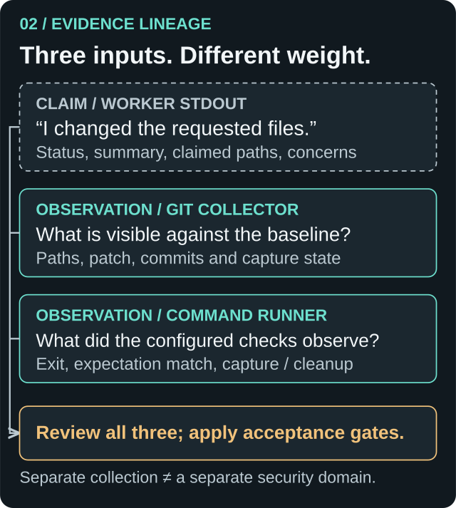
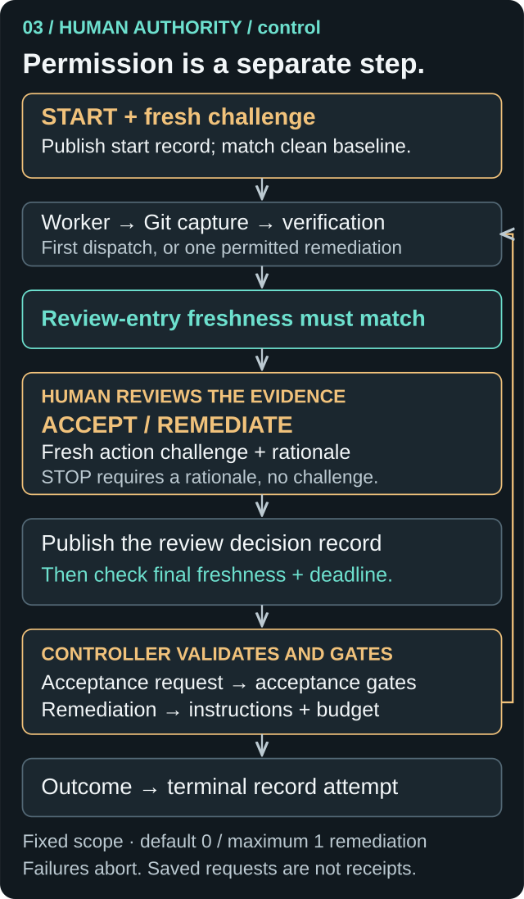
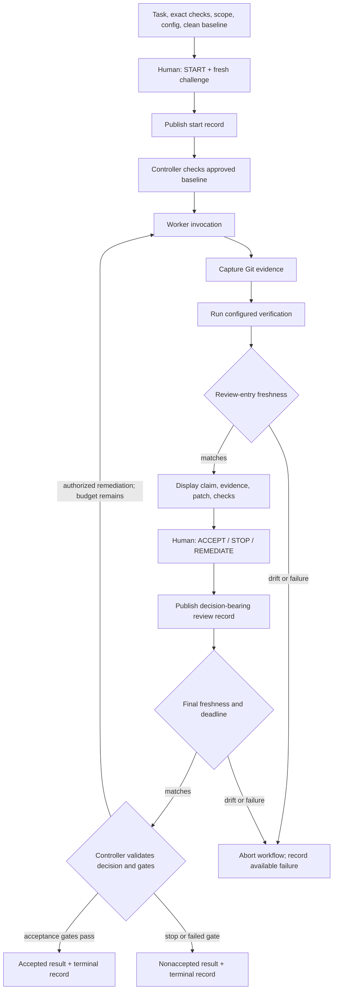
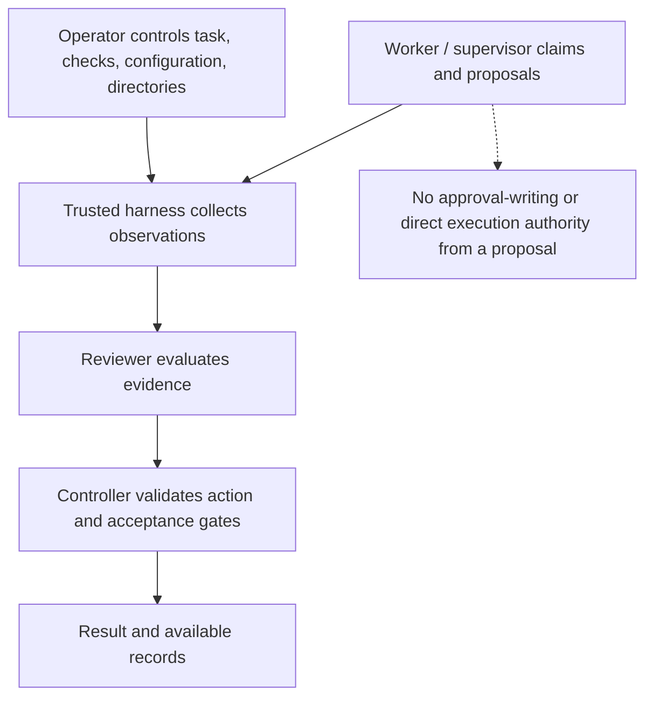

# Architecture and trust boundaries

[README](../README.md) · [CLI guide](usage.md) · [Report contract](reports.md)

## Two workflows, one evidence principle

`run` calls `orchestrator.run_task` once. It returns a `TaskRunResult` containing the worker result, baseline/final SHAs, changed paths, patch, verification, and mechanical findings. It has no reviewer callback or remediation loop.

`control` calls `HarnessController` with `HumanReviewer`, a validated Windows console, create-only records, an approved baseline, `stdin=DEVNULL` for worker/check subprocesses, and rejection of unsupported Git index flags. The library controller can also be used directly; those CLI protections are not its default configuration.

## Evidence lineage

*Claims describe the worker’s account. Observations describe what the harness could capture. Neither alone grants acceptance.*

| Input | Produced by | What it establishes | What it cannot establish |
| --- | --- | --- | --- |
| Task and configured checks | Caller/operator | Declared goal, criteria, commands, file scope | That the criteria are sufficient |
| Completion record | Worker stdout | A parsed worker claim | That the work or file list is correct |
| Process observation | Harness process runner | Observed launch, exit, timeout, output/capture/cleanup state | Universal termination of all descendants |
| Git evidence | Harness Git collector | Changes visible at the capture point against a baseline | Ignored files, external effects, changes reverted before capture |
| Verification result | Harness command runner | Observed outcome of the configured command | Semantic correctness beyond what that command checks |
| Review decision | Reviewer | A requested action and rationale | That controller gates accepted or processed it |
| Terminal record | Control wrapper | Available controller outcome or failure evidence | Authentication, crash durability, or resume authority |

“Independent” describes collection outside the worker's self-report. Worker, Git, checks, and records still share the operator's machine and trust environment.

### Git capture

The baseline must be clean. Cumulative evidence stays anchored to its original commit: HEAD, status, changed paths, commits, and a patch including non-ignored untracked files. Both ends of a rename count toward scope.

Before each controller worker invocation, a temporary index and `write-tree` capture the current worktree. A second snapshot supports per-attempt comparison even after earlier work left the repository dirty. It does not stage the real index, but it writes objects into Git storage.

The controller compares a worker's per-invocation file claims with per-attempt observations. Disagreement produces an audit event; it is not itself an acceptance veto. Scope gates use cumulative Git paths. The single-run path instead reports worker/Git disagreement and worker-created commits as mechanical findings.

Evidence phases have shared monotonic deadlines and per-command byte caps. Failed, truncated, incomplete, late, or cleanup-uncertain collection cannot yield successful evidence. See [R4 budgets and ownership](reliability-r4-bounded-git.md); current index-entry capture additionally has a 4 MiB cap in [git.py](../coding_agent_harness/git.py).

The supervisor's separate preflight reader uses a 10-second subprocess timeout without stdout/stderr byte caps. The evidence collector's byte-limit guarantees do not extend to that reader.

## Human authority in `control`

*The return edge is permission to invoke the worker once more, not an automatic retry after a failed check. Publication and freshness failures stop the transition. A terminal-record failure cannot undo a controller outcome that already occurred.*

Detailed control flow, including failure exits

Start publication, baseline matching, review publication, and final freshness must succeed before their downstream action. Failures at other stages also abort; the diagram shows the two freshness boundaries explicitly. No test outcome or completion message follows the human-action edges automatically.

`START` authorizes exactly the first dispatch under the displayed configuration. `ACCEPT` and `REMEDIATE` each need a fresh action challenge and nonblank rationale; remediation also needs bounded instructions and an enabled remaining budget. `STOP` needs a rationale but no challenge. Invalid input may be retried within the same deadline; it grants no authority and does not reset that deadline. EOF, timeout, Ctrl+C, unavailable console, rendering, publication, or freshness failure cannot grant acceptance or another attempt.

The CLI permits only 0 or 1 remediation (default 0), with fixed file scope. The library default is 2 additional invocations shared between remediation and scope revision. A scope revision is a validated `revise-scope` decision with a nonempty allowlist and rationale; it consumes the same budget and triggers another worker attempt. It is not offered by the human CLI.

### Acceptance gates and intentionally unusual semantics

The controller revalidates reviewer output before branching, including mutated or unvalidated model instances. An accept request cannot override worker execution/protocol failure, cumulative file-scope violations, or failed aggregate verification.

A valid worker completion status of `blocked` or `failed` can still be accepted by a reviewer if those gates pass; the controller emits a worker/reviewer disagreement event. Worker status and reviewer judgment are deliberately distinct. An infrastructure failure permits stopping, but prevents remediation and scope retries.

### Freshness is an observation

At review entry and after decision-record publication, `HumanReviewer` compares the expected post-worker evidence with a fresh capture against the same baseline. It checks HEAD, status, paths, commits, patch text and raw-byte digest, staged-entry fingerprint, and index-flag observation. Control rejects `assume-unchanged` and `skip-worktree` flags; otherwise edits can disappear from ordinary Git observations.

The staged fingerprint hashes exact `git ls-files --stage -z` bytes with a domain prefix. It covers paths, modes, object IDs, and stages rather than index-file timestamps. Raw patch hashing avoids treating different byte sequences as equal after replacement decoding.

A mismatch aborts: the packet is not silently replaced, verification is not rerun, and no follow-up dispatch is inferred. These sequential Git operations are not an atomic filesystem snapshot. Concurrent changes after the final check, ignored/external state, and malicious same-user access remain outside the guarantee.

## Separation of authority

These are logical roles, not OS security principals. All local processes may have the same user permissions. The [supervisor handoff](supervisor-handoff.md) requires operator-controlled approval storage and a caller-supplied inventory of writable roots. It validates documents without launching workers. Its approval files do not authorize the separate `control` workflow, and direct `run` or library calls can bypass that sidecar.

## Records and their limits

`control` creates `start-<uuid>.json`, `review-<uuid>.json`, and `terminal-<uuid>.json` with identifiers and digest references. Start publication precedes dispatch. A decision-bearing review record precedes final freshness and callback return.

The terminal projection distinguishes publication, completed final freshness, controller receipt, and controller processing when observable. A saved human request cannot establish every later stage. A terminal publication failure after controller acceptance does not undo that decision; the CLI reports an error and retains available evidence of the actual outcome. A missing terminal record means an incomplete workflow.

Records are unredacted, unsigned, unauthenticated, and not crash-durable. They are neither resumable checkpoints nor portable execution capabilities. Directory independence and stability are operator responsibilities, as with [single-run reports](reports.md).

## Component map

| Source | Responsibility |
| --- | --- |
| [models.py](../coding_agent_harness/models.py) | Task, completion, verification specification, and decision models; unknown fields rejected |
| [worker.py](../coding_agent_harness/worker.py) | Configured Qwen subprocess, prompt, strict completion parser, outcome classification |
| [process.py](../coding_agent_harness/process.py) / [verifier.py](../coding_agent_harness/verifier.py) | Process observation, bounded capture/waits, command expectations |
| [git.py](../coding_agent_harness/git.py) | Baseline, cumulative and per-attempt observations, temporary-index ownership |
| [orchestrator.py](../coding_agent_harness/orchestrator.py) | Single invocation and mechanical findings |
| [controller.py](../coding_agent_harness/controller.py) | Reviewer-driven acceptance, scope revision, bounded retries, audit events |
| [control.py](../coding_agent_harness/control.py) / [human_review.py](../coding_agent_harness/human_review.py) / [console.py](../coding_agent_harness/console.py) | Human authorization, freshness, rendering, Windows input |
| [report.py](../coding_agent_harness/report.py) / [control_records.py](../coding_agent_harness/control_records.py) | Create-only publication of captured records |
| [supervisor.py](../coding_agent_harness/supervisor.py) | Nonexecuting handoff, proposal validation, exact approval binding and preflight |

For library use, supply `worker.run(*, task, repo_dir)` and `reviewer.review(*, task, worker_result, worker_assessment, evidence, verification, attempt)`. Construct `HarnessController(worker=..., reviewer=..., max_remediation_attempts=2)`, then call `run(task=..., repo_dir=..., verification_commands=...)`. The reviewer returns a `ReviewDecision`; the result holds status, attempts, and audit events. Full evidence reaches the reviewer callback rather than being automatically persisted by the bare controller.
